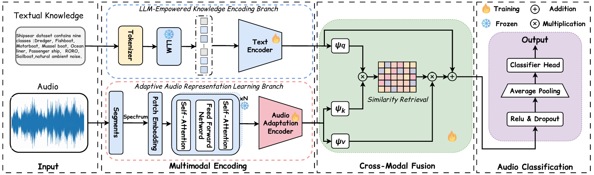

<h1 align="center">
KMA-UATR: Knowledge-Guided Multi-modal Underwater Acoustic Target Recognition with Adapted Audio Foundation Models
</h1>

  Xudong Jiang1, Hamadoun Diallo1, Haoqin Yang1, Yangyang Ding1, Wengen Li1, Jihong Guan1, Yichao Zhang1, Shuigeng Zhou2 
  1Tongji University, Shanghai, China &emsp; 
  2Fudan University, Shanghai, China 

 

  

 

This is the official repository for **AdaMamba**, a novel framework that endogenizes adaptive and context-aware frequency analysis within the Mamba state-space update process.
